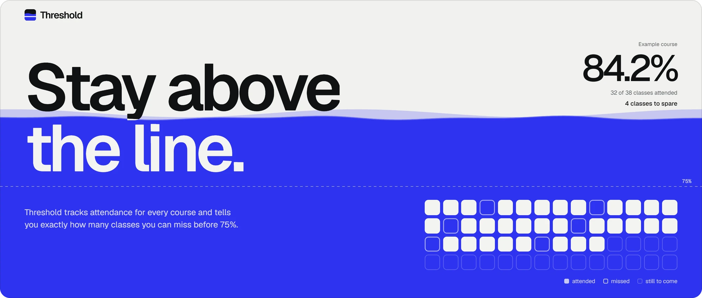
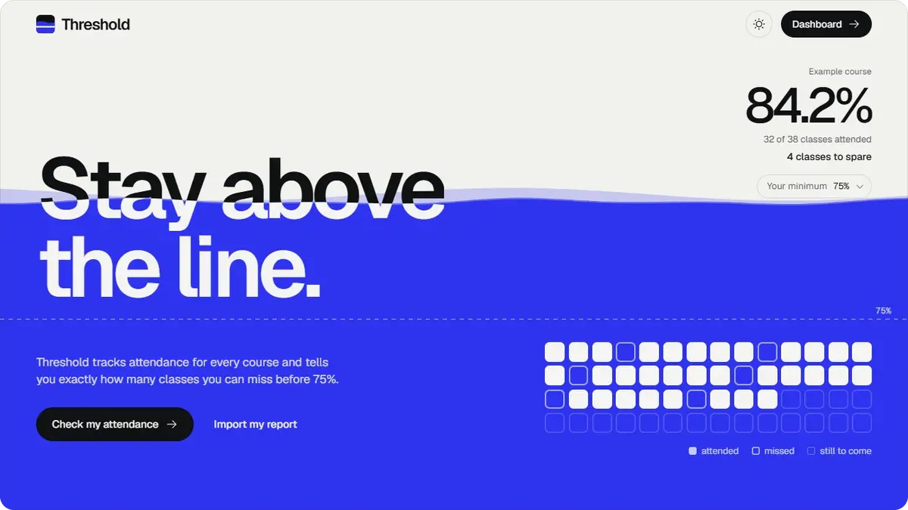
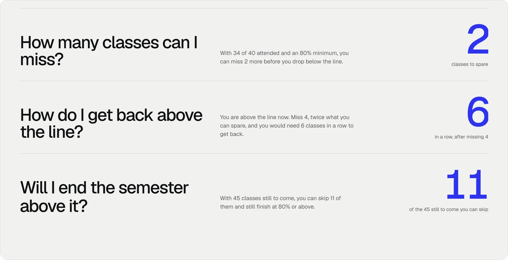
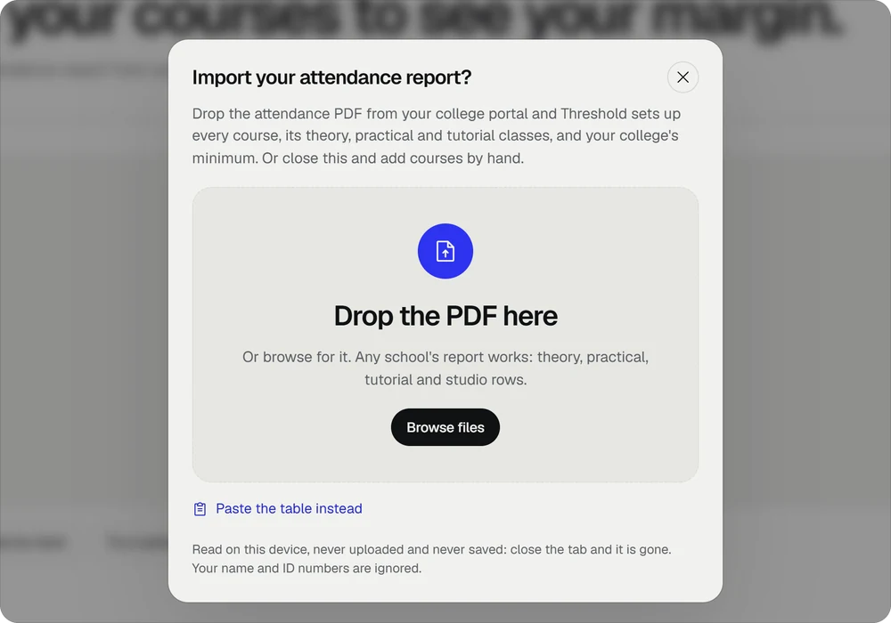
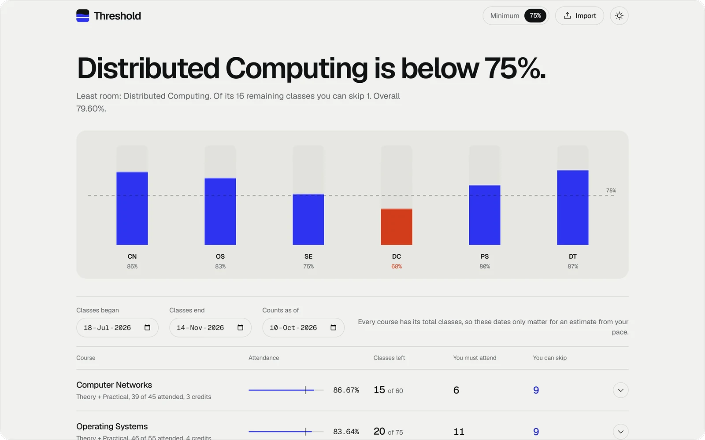
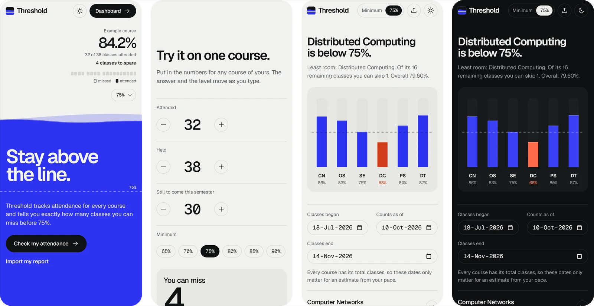

<a href="https://stayabove.vercel.app">
  <picture>
    <source media="(prefers-color-scheme: dark)" srcset=".github/media/banner-dark.webp">
    
  </picture>
</a>

 

  <b>Threshold</b> tells a student exactly how many classes they can still miss, in every course, 
  and how many it takes to climb back once they slip below the line.

  

  No account&ensp;·&ensp;Nothing uploaded&ensp;·&ensp;Any college, any minimum

 

<picture>
  <source media="(prefers-color-scheme: dark)" srcset=".github/media/film-dark.webp">
  
</picture>

 
 

### Three answers. Every course.

How many classes can still be skipped. How many in a row it takes to get back above the line. Whether the semester ends above it. Every answer is a whole number, worked out exactly and never rounded in the student's favour.

<picture>
  <source media="(prefers-color-scheme: dark)" srcset=".github/media/answers-dark.webp">
  
</picture>

 
 

### Drop the report. Skip the typing.

Students drop in the attendance PDF their college portal already gives them, and Threshold builds the whole semester from it: every course, every theory and lab row, the college's own minimum. The file is read on the device and never leaves it.

<picture>
  <source media="(prefers-color-scheme: dark)" srcset=".github/media/import-dark.webp">
  
</picture>

 
 

### The semester, at a glance.

One tank per course on a shared scale, with the minimum drawn as a line across all of them. The course in trouble is always the headline.

<picture>
  <source media="(prefers-color-scheme: dark)" srcset=".github/media/dashboard-dark.webp">
  
</picture>

 
 

### Made for the phone in their pocket.

 
 

  
    
  Plain JavaScript, Canvas and PDF.js. Built for Coursera's <i>Playing with AI</i>, with Claude Code as the pair programmer.
   
  © 2026 Dhruv Sonar. All rights reserved.

