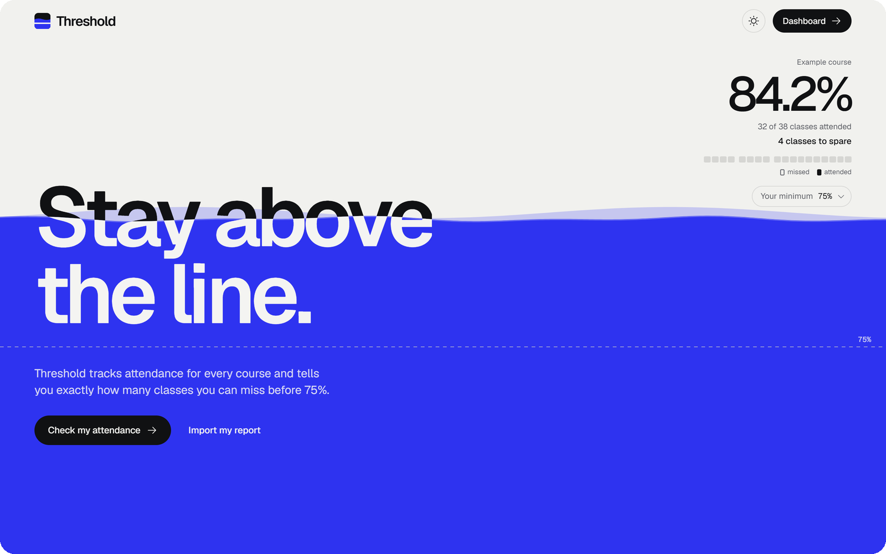
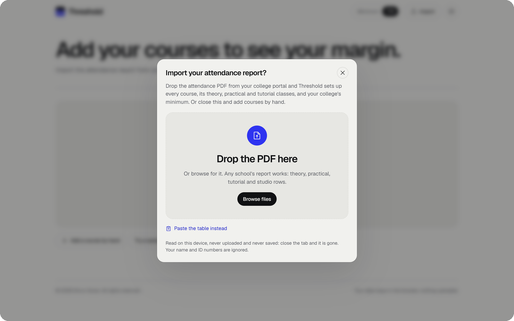
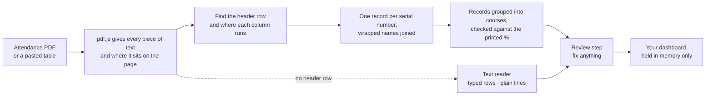
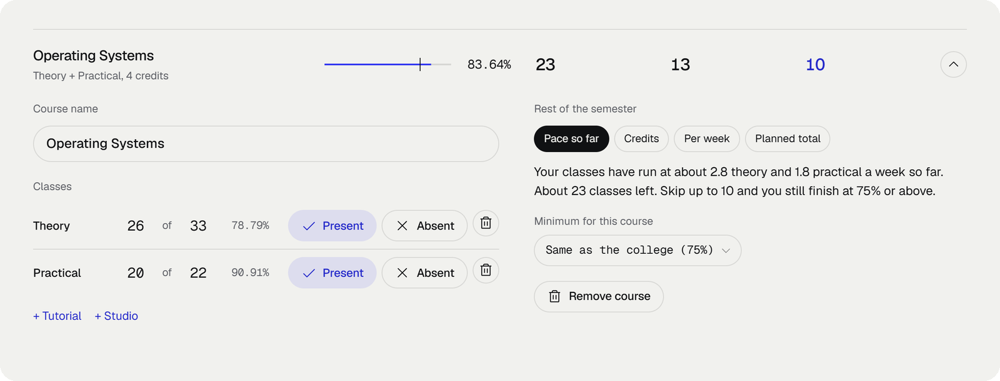
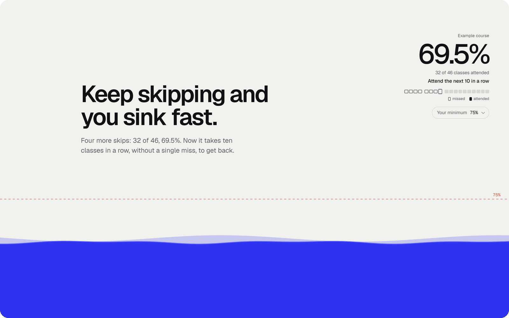
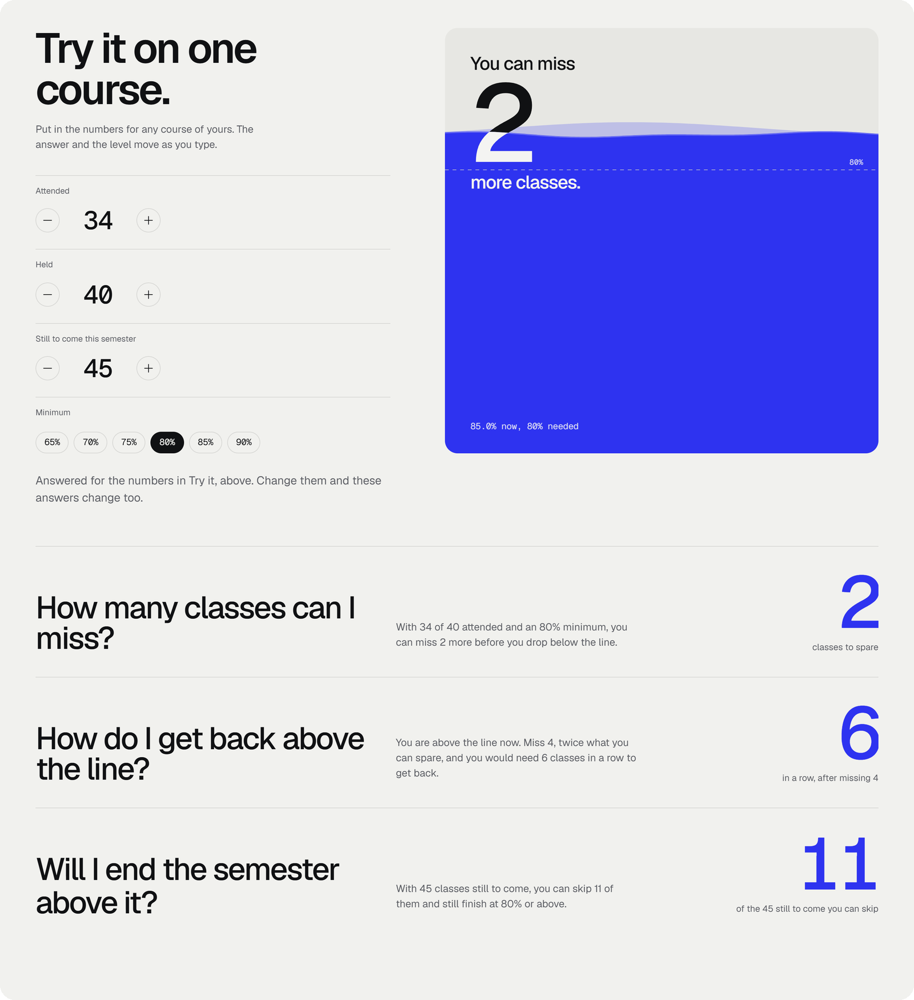
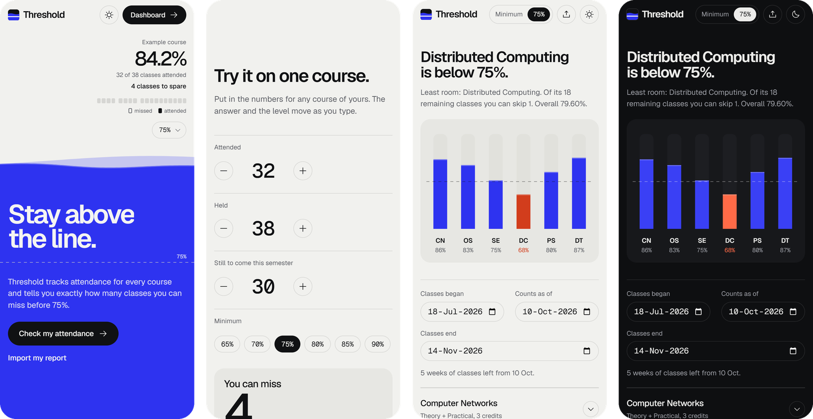

<div align="center">


# Threshold

**Stay above the line.**

See how many classes you can miss in every course,<br>under whatever attendance rule your college runs.

[**stayabove.vercel.app**](https://stayabove.vercel.app) &nbsp;·&nbsp; [Open the dashboard](https://stayabove.vercel.app/dashboard/) &nbsp;·&nbsp; [Dev log](docs/DEVLOG.md) &nbsp;·&nbsp; [Changelog](CHANGELOG.md)

<br>


</div>

<br>

<p>
<picture>
  <source media="(prefers-color-scheme: dark)" srcset="docs/media/hero-dark.png">
  
</picture>
</p>

<br>

Most Indian colleges stop you from sitting end-semester exams if your attendance drops below a minimum. That minimum is usually 75%, and sometimes 80% or 85%. So every student ends up doing the same sum in their head before skipping a class, and the usual formula for it is often wrong.

Threshold works it out for you, for every course you take. Drop in the attendance PDF from your college portal, from any school, and it sets everything up. Nothing is uploaded, and nothing is saved.

<br>

## Three answers, for every course

| | Question | What Threshold says |
|:-:|---|---|
| **1** | How many classes can I miss? | The exact number you can still skip without dropping below the line. |
| **2** | How do I get back above it? | How many classes in a row you must attend, without a miss, to climb back. |
| **3** | Will I end the semester above it? | Of the classes still to come, how many you can skip and still finish at the minimum. |

> **Example.** 32 of 38 classes attended, with a 75% minimum. You can miss **4** more: 32 of 42 is 76.2%, but 32 of 43 is 74.4%. Miss 8 instead and you would need **10** classes in a row to get back. With 30 classes still to come, you can skip **11** of them and still finish at 75%.

<br>

## The maths, in whole numbers

The variables are:
- $a$: classes attended;
- $t$: classes held;
- $p$: the minimum, as a whole percent (75, not 0.75);
- $L$: classes still to come.

```math
\text{can miss} = \left\lfloor \frac{100a - p\,t}{p} \right\rfloor
\qquad
\text{in a row to recover} = \left\lceil \frac{p\,t - 100a}{100 - p} \right\rceil
```

```math
\text{can skip of the } L \text{ still to come} = a + L - \left\lceil \frac{p\,(t + L)}{100} \right\rceil
```

Every calculation stays in integers. Writing the minimum as `75` rather than `0.75` makes `100 * a` and `p * t` exact, so floating point never gets a say.

That matters more than you would think. The textbook decimal formula gives the wrong answer in **2,614 of 3,320 cases** at an 80% minimum (every case up to 80 classes), because `1 - 0.8` is `0.19999999999999996` in floating point. For example, with 3 of 5 attended it says you must attend 6 in a row. The real answer is 5.

<details>
<summary><b>Where the decimal formula breaks, by minimum</b></summary>

<br>

| Minimum | Wrong answers out of 3,320 |
|:-:|:-:|
| 60% | 47 |
| 65% | 196 |
| 70% | 0 |
| 75% | 0 |
| 80% | **2,614** |
| 85% | 22 |

At 75% it happens to be right, which is why most online calculators look fine until your college asks for 80%. `tests/core.test.js` checks every function against a brute-force count for 8 minimums and every case up to 80 classes.

</details>

<br>

## Bring your own report

<p>
<picture>
  <source media="(prefers-color-scheme: dark)" srcset="docs/media/import-dark.png">
  
</picture>
</p>

Drop in the attendance PDF from your college portal, or paste the table, and Threshold builds the semester for you. It reads every course by its name, with its theory, practical, tutorial and studio rows, your college's minimum and the dates of the report. Law, pharmacy, commerce, business, engineering and design reports all work.



- **It reads the page, not the order the text comes out in.** pdf.js gives every piece of text with its position. Threshold finds the header row and works out where each column runs. Header words stacked over two or three lines join the column under them. Every piece below goes to the column under its centre, so a name that wraps ("LAW OF TORTS AND" / "CONSUMER PROTECTION") rejoins its row, and a row cut by a page break carries on.
- **Subjects, not class types.** The name comes from the course column. The type column (THEO, PRAC, TUTL, Lab, Seminar, Moot court…) only decides whether a row is theory, practical, tutorial or studio, and rows with the same course name become the parts of one course.
- **Any table with a header.** Columns are known by their words: serial number, course or subject, code, type, held (conducted, delivered, total), attended (present), absent, percentage and credits. Absent-only columns, "23/27" fractions, separate theory and lab columns, merged course cells and totals rows are all handled.
- **Checked against the report.** Most reports print each course's percentage. The review step says whether every course adds up to it, so a misread never goes unnoticed.
- **A fallback for the rest.** Text with no header row goes to the text reader, which anchors on type words ("THEO 30 27") or reads plain "name, held, attended" lines in any column order.
- **pdf.js loads only when you import**, in its legacy build for older phones, with `isEvalSupported: false` so nothing inside a PDF is ever compiled. Names and ID numbers on the report are ignored.

<br>

## Built for any college, any course

- **Any minimum.** Pick 60 to 90% in one tap, or type anything from 1 to 100.
- **Theory and practical, together or apart.** Count every class against one minimum, as NMIMS does. Or judge each type separately, with its own lab minimum. Any course can override the college rule.
- **Courses made of parts:** theory, practical, tutorial and studio, each with its own counts.
- **Four ways to know how many classes are left:**
  - **Pace so far** (the default): classes held ÷ weeks elapsed × weeks left.
  - **Credits:** uses the AICTE definition, where 1 credit is 1 lecture hour or 2 lab hours a week. Each lab part takes one credit and theory gets the rest. A 3-credit course with a lab comes out at 2 lecture hours and 2 lab hours a week, about 60 classes over a 15-week semester.
  - **Per week:** you set the number for each part.
  - **Planned total:** taken from the course's session plan.

<br>

## The dashboard

<p>
<picture>
  <source media="(prefers-color-scheme: dark)" srcset="docs/media/dashboard-dark.png">
  
</picture>
</p>

- **The headline is the one thing to know right now:** which course is below the line, or which has the least room.
- **One tank per course**, on a shared scale with your minimum as a dashed line. Tanks near the cursor swell like a dock, and the water reaches toward the pointer.
- **Every row shows** classes left, how many you must attend and how many you can skip, without opening it. Change the minimum and every number follows.
- **No dates yet?** The rows still say what the minimum allows today: how many classes you can miss now, or how many in a row it takes to get back.
- **Percentages to two decimals**, rounded the way reports print them, so 77.78% on the report is 77.78% here. Nothing is ever rounded up onto the line: 79.996% shows as 79.99%.
- **Log a class in one tap**, Present or Absent for each part, with an undo after every change.

<p>
<picture>
  <source media="(prefers-color-scheme: dark)" srcset="docs/media/course-dark.png">
  
</picture>
</p>

<br>

## The landing page tells the story

<p>
<picture>
  <source media="(prefers-color-scheme: dark)" srcset="docs/media/story-dark.png">
  
</picture>
</p>

As you scroll, an example course skips classes. The water sinks, the line turns red, and then the course climbs back. The readout in the corner doubles as a progress bar, with one mark per class. Every number in the story is generated for whichever minimum you choose, so the copy is true at 70% just as it is at 85%. `tests/story.test.js` checks this for every minimum from 50% to 95%.

Then you try it on one of your own courses. The vessel fills to your attendance as you type, and the three answers below follow every number.

<p>
<picture>
  <source media="(prefers-color-scheme: dark)" srcset="docs/media/answers-dark.png">
  
</picture>
</p>

<br>

## On your phone

<p></p>

The layout uses `svh` units, so mobile browser bars never crop it. Inputs are 16px, which stops iOS from zooming in. Sheets slide up from the bottom, and everything respects the safe areas. On a phone the readout sits in the top corner, so story text holds still at its anchor and dissolves there instead of sliding underneath. Hover effects only switch on for a real mouse.

<br>

## Design notes

- **Nothing snaps.** The story is scrubbed to the scroll with GSAP ScrollTrigger on a Lenis smooth scroll, so it moves exactly as far as your finger does.
- **Real liquid.** The water is a 1D height field of springs on a canvas. Ripples travel and settle, and the level sloshes a little when it changes. Text crossing the surface turns white where the water covers it, using two layers clipped by the wave.
- **Cursor-aware, never pushy.** Buttons lean toward a nearby cursor by at most 3 px, so neighbours never touch. An automated sweep checks every pair for overlaps.
- **The theme floods in.** Switching light and dark pours the new theme out from the toggle as a wobbling blob, using the View Transitions API.
- **Reduced motion is respected:** the story stays readable without any of it.

<br>

## Under the hood

| Part | What it uses |
|---|---|
| **Build** | Vite 6, two pages (landing and dashboard), vanilla JavaScript, no framework |
| **Motion** | GSAP 3.15 (ScrollTrigger, SplitText), Lenis 1.3 |
| **Graphics** | Canvas 2D: height-field liquid, the tank chart, text inversion |
| **PDF** | pdfjs-dist 4.10, legacy build, lazy-loaded; text positions read into a table |
| **Type and icons** | Geist and Geist Mono via Fontsource, Phosphor icons inlined as SVG |
| **Storage** | None for your data: courses live in memory. Only the theme is remembered |
| **Hosting** | Vercel, deploys on every push to `main` |

**Weight:** the landing page ships about 76 kB of gzipped JavaScript, and the dashboard about 52 kB. pdf.js (123 kB gzipped) loads only when someone imports a report.

<details>
<summary><b>Project layout</b></summary>

```
threshold/
├── index.html              landing page
├── dashboard/index.html    the dashboard
├── src/
│   ├── core.js             attendance maths, whole numbers only
│   ├── plan.js             courses, parts, rules, dates, classes left, credits
│   ├── table.js            the report reader: positions, header, columns, rows
│   ├── parse.js            the text reader, class types, names, minimum and dates
│   ├── report.js           reading a file or a paste, shared by both pages
│   ├── pdftext.js          pdf.js text and positions, loaded on demand
│   ├── story.js            the landing story, worked out for any minimum
│   ├── landing.js          landing page: scroll story, Try it, the three answers
│   ├── dashboard.js        the dashboard
│   ├── liquid.js           canvas liquid and text inversion
│   ├── skyline.js          the dashboard's tank chart
│   ├── magnet.js           cursor-aware details
│   ├── theme.js            light and dark, with the flood transition
│   ├── store.js            state checks, the hand-off from the landing page, the sample
│   ├── icons.js            Phosphor icons
│   └── styles/             base.css, landing.css, dashboard.css
├── tests/                  node:test suites for core, parse, table, plan and story
├── public/                 icons, web manifest, social card
├── docs/
│   ├── DEVLOG.md           the full build log
│   └── media/              README images
├── vercel.json             sends the old /app address to /dashboard
└── CHANGELOG.md            what changed in each release
```

</details>

<br>

## Run it locally

You need Node 18 or newer.

```bash
npm install
npm run dev        # http://localhost:5173
npm test           # 29 tests: maths, readers, planning, story
npm run build      # static site in dist/
npm run preview    # serve the build
```

The tests cover these areas:
- **core:** every function against a brute-force count, plus the edge cases: no classes yet, exactly on the line, a 100% minimum, and attended above held.
- **parse:** the text reader on a synthetic SAP-style report and on spreadsheet pastes in any column order, every way a minimum gets phrased, course names, and junk input.
- **table:** the position reader on synthetic reports: a stacked header repeated on page two, TUTL rows, wrapped names, a row split by the page break, footnotes, codes, absent columns, fractions, merged cells, totals rows, counts split into theory and lab columns, and a course that does not add up to its printed percentage. Plus class types, names and dates in any common format.
- **plan:** credits to weekly classes, all four ways of counting classes left, combined and separate rules (with counts summed over the parts), course overrides and dates.
- **story:** the landing story is true for every minimum from 50% to 95%.

<br>

## Privacy

- No accounts, no server, no analytics, no cookies.
- **Nothing is saved.** Your courses live in the page's memory and are gone when you close or reload the tab. Versions before 2.0 kept them in `localStorage` under `threshold.v2`; that copy is deleted on your next visit.
- The theme is the one thing remembered, under `threshold.theme`.
- A report dropped on the landing page reaches the dashboard through `sessionStorage` (`threshold.pending`), which is removed as soon as it is read.
- PDFs are read on your device and never uploaded. Names and ID numbers on them are ignored.

<br>

## How it was made

Threshold was built on 10 October 2026 for the Coursera project *Playing with AI*, working with Claude Code as the AI pair programmer. It came together over several rounds of feedback:

| Round | What landed |
|---|---|
| **1** | The liquid landing page, text that inverts under the water, whole-number maths, a simple planner |
| **2** | Courses made of parts, any minimum, credits, PDF and paste import, the tank chart, the theme flood, phones |
| **3** | Live on Vercel, the logo, the import prompt, cursor-aware details, rows that show attend and skip at a glance |
| **After launch** | Subtler hover, a landing page that explains itself, answers that follow your numbers, a frosted nav, text kept clear of the readout |
| **2.0** | A report reader that works by position, for any school's report, checked against the printed percentages; the planner became the dashboard; nothing kept between visits |

Every decision, bug and fix is written up in **[docs/DEVLOG.md](docs/DEVLOG.md)**, and each release is in **[CHANGELOG.md](CHANGELOG.md)**.

<br>

## License

© 2026 Dhruv Sonar. All rights reserved.

This code is not open source. You may not copy, modify or redistribute it without written permission.

<br>

<div align="center">
<sub>Your data stays in the browser, nothing uploaded.</sub>
</div>
